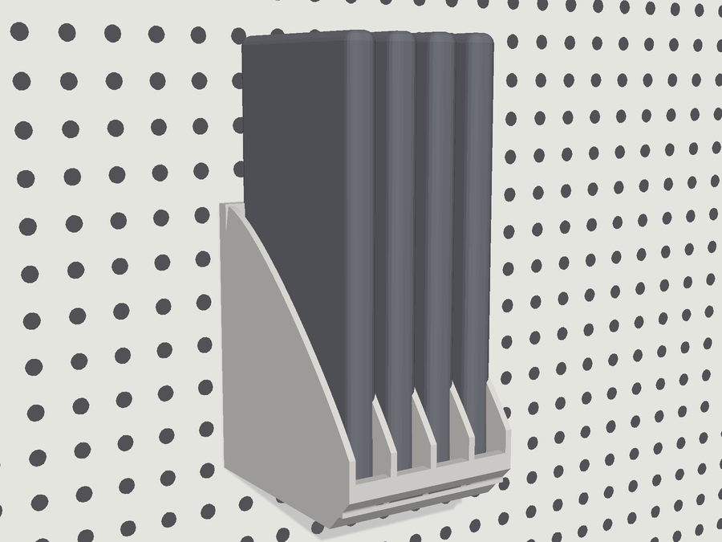
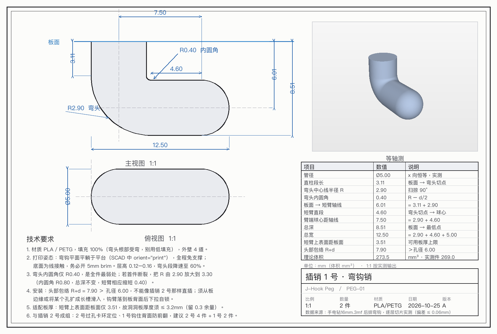
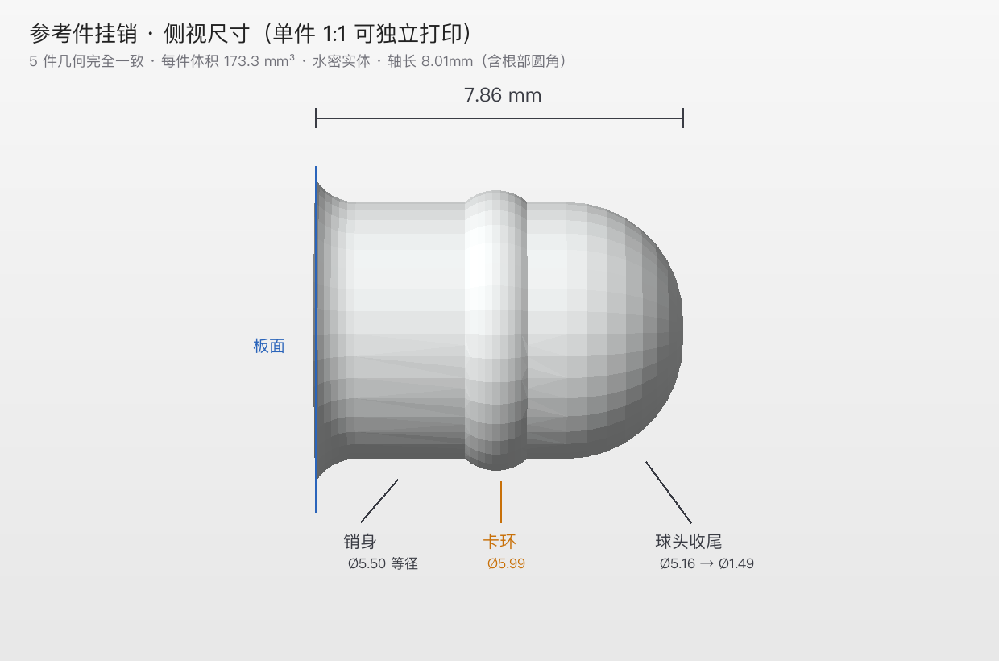

# 洞洞板 3D 配件

适配 **孔径 6 mm / 孔中心距 16 mm**（6 mm 孔 + 10 mm 边距）标准洞洞板的 3D 打印配件。

全部模型以 **OpenSCAD 参数化** 方式建模，尺寸来自实物逆向测量，可按自己的洞洞板公差现场调参。目标打印机：**拓竹 Bambu Lab A1**（0.4 喷嘴），全件免支撑。

---

## 目录

| # | 作品 | 文件 | 说明 |
|---|---|---|---|
| 01 | **手机收纳盒**（4 槽） | [`01-phone-holder/`](01-phone-holder) | 手机像书一样立放，槽底留充电过线窗 |
| 02 | **插销 1 号**（弯钩销） | [`02-peg1-hook/`](02-peg1-hook) | J 形弯钩，用于悬挂、卡边、挂线 |
| 03 | **插销 2 号**（直插销） | [`03-peg2-straight/`](03-peg2-straight) | Ø5.50 销身 + 卡环过孔自锁，最通用 |



---

## 共同规格

| 项目 | 数值 |
|---|---|
| 孔径 | Ø6.00 mm |
| 孔中心距 | 16.00 mm |
| 建议板厚 | 2.5 – 3.2 mm（受插销 1 号限制，见下） |
| 打印层高 | 0.20 mm |
| 墙数 / 填充 | 4 墙 / 15 % Gyroid |
| 支撑 | 全部免支撑 |

---

## 01 手机收纳盒

**外形** 66 × 96 × 100 mm，体积 123.9 cm³（约 85 g / 4–5 h）。

- 4 个卡槽，槽宽 13.5 mm、隔板 2.4 mm，手机带壳通用
- **槽深 88 mm > 手机宽度（iPhone 约 72 mm）**，这是"像书一样立"的硬约束——槽浅了底边会顶到前挡唇
- 每个槽底开 14 mm 过线窗，数据线从下方穿上直插手机
- 前面有 12 mm 挡唇 + 隔板前伸 8 mm，手机不会前倾滑出
- 背板 6 个挂销（3 排 × 2），排距 32 mm = 2 个孔距

**文件**

```
01-phone-holder/
├── phone-holder.scad     参数化源文件（本文件坐标 = 打印坐标）
├── phone-holder.stl      打印文件
├── print-guide.md        打印说明（尺寸表 / 参数 / 安装步骤 / 调参速查）
├── print-guide.html      带渲染图的单页说明
└── preview/              渲染预览图
```

**安装**：6 个销同时对孔 → 垂直压入 → 听到/感到"咔"一下即到位。拆卸时贴墙向外平推，不要单侧硬掰。

---

## 02 插销 1 号 · 弯钩销



几何从参考件 `手电钻16mm.3mf` 逆向提取，参数化重建后与实物网格的顶点偏差 **均值 0.018 / P95 0.054 / 最大 0.098 mm**（最大值为切割余量），可视为同一零件。

| 项目 | 数值 |
|---|---|
| 管径 | Ø5.00 |
| 直柱段长（板面 → 弯头切点） | 3.11 |
| 弯头中心线半径 R | 2.90（扫掠 90°） |
| 弯头内圆角 | 0.40 |
| 板面 → 短臂轴线 | 6.01 |
| 短臂直段 | 4.60 |
| 臂端球心距轴线 | 7.50 |
| **总深 / 总宽** | **8.51 / 12.50** |
| 体积 | 273.3 mm³ |

**两个必须知道的限制**

1. **它不能直插 Ø6 孔。** 头部包络 R+d = 7.90 mm > 孔径 6.00 mm，任何角度都过不去。只能从板的边缘或长槽侧向滑入。
2. **洞洞板厚度必须 ≤ 3.2 mm。** 短臂上表面距板面只有 3.51 mm，板一厚就会与钩臂干涉。板厚 5 mm 的话需要把 `stem` 加长 1.5–2 mm。

**最弱处**：弯头内圆角仅 R0.40，是全件应力集中点。若首件在弯头断裂，把 `R` 从 2.90 放到 3.30（内圆角变 0.80，总深不变、短臂自动缩 0.40）。

**打印**：平躺（8.51 × 12.50 × 5.00），建议 5 mm brim。

```
02-peg1-hook/
├── peg1-hook.scad        参数化源文件（顶部 d / stem / R / arm 四个数可调）
├── peg1-hook.stl         打印姿态 STL
├── peg1-reference.stl    从参考件直接切出的原件，可对照
├── peg1-design.png       三视图 + 尺寸链 + 技术要求
└── peg1-dims.json        实测尺寸数据
```

---

## 03 插销 2 号 · 直插销



同样是参考件逆向。结构是 **Ø5.50 等径销身 + Ø5.97 卡环 + 球头收尾**，靠卡环过孔时的微量挤压与销身微锥摩擦止退，比弹簧卡扣更耐久。

| 距板面 | 直径 | 部位 |
|---|---|---|
| 0.15 – 0.9 | Ø6.46 → Ø5.60 | 根部圆角过渡 |
| 1.2 – 3.3 | **Ø5.50** | 销身（等径略呈微锥） |
| **3.95** | **Ø5.97** | **卡环峰（唯一凸起）** |
| 4.7 – 5.5 | Ø5.50 | 销身 |
| 6.4 | Ø5.16 | 收腰 |
| 6.4 – 8.01 | Ø5.16 → Ø1.49 | 球头收尾 |

原始剖面数据见 [`peg2-profile.json`](03-peg2-straight/peg2-profile.json)（0.05 mm 步长，160 点）。

**公差提醒**：参考件卡环 Ø5.97 对 Ø6.00 孔属于"零过盈"。FDM 打出来的孔常偏小 0.1–0.2，照抄会插不进。建议首件把 `rib_d` 调到 **6.20** 试装，太紧减 0.1、太松加 0.1，可用区间 6.0–6.4。

```
03-peg2-straight/
├── peg2-straight.scad        参数化源文件（single / row 两种输出模式）
├── peg2-straight.stl         单件（轴竖立，直接打印）
├── peg2-straight-x5.stl      5 连排，间距 4 mm，一次打齐
├── peg2-design.png           侧视尺寸图
├── peg2-profile-curve.png    直径随距板面变化曲线
├── peg2-profile.json         原始剖面数据
└── peg2-row-preview.png      5 销排布渲染
```

---

## 改参数重出 STL

不需要打开 GUI，命令行即可：

```bash
# 改板厚 → 手机盒（示例：背板改 6 mm、卡环放大到 6.25）
OpenSCAD -D 'back_t=6' -D 'rib_d=6.25' -o out.stl 01-phone-holder/phone-holder.scad

# 插销 2 号：一次打 10 件，间距 5 mm
OpenSCAD -D 'mode="row"' -D 'count=10' -D 'gap=5' -o pegs10.stl 03-peg2-straight/peg2-straight.scad

# 插销 1 号：板厚 5 mm 的洞洞板，直柱段加长
OpenSCAD -D 'stem=5.11' -o hook5.stl 02-peg1-hook/peg1-hook.scad
```

主要可调参数都在每个 `.scad` 顶部的 `/* [组名] */` 分组里，OpenSCAD GUI 的 Customizer 面板会直接列出来。

---

## 工具脚本

`tools/` 里是建模期间自写的辅助脚本（Python 3，依赖 `trimesh numpy manifold3d pillow`），非必需：

| 脚本 | 用途 |
|---|---|
| `extract_pegs.py` | 从 3MF 参考件布尔切出挂销 |
| `render_lib.py` | 自写 z-buffer 渲染器（透视投影 + 平面着色 + 阴影 + 洞洞板背景） |
| `render_pegs.py` | 挂销侧视尺寸图与直径剖面曲线 |
| `draw_peg1.py` | 插销 1 号三视图（PIL 手绘 + 尺寸链 + 引注箭头） |
| `build_card.py` | 把渲染图 base64 内嵌成单文件 HTML |

---

## 已知取舍

- **手机盒槽深 88 mm** 是为容纳带壳 iPhone 定的；小屏手机可以在 `depth` 上减到 78 但别低于手机宽度。
- **插销排布间距 32 mm** 是 2 个孔距，如果你的板孔距不同（如 25 mm），改 `pitch` 并让排距等于 2×`pitch`。
- **弯钩销** 是逆向自某个电钻支架的挂件，本仓库只复刻几何、不含原支架。
- 未附许可证文件。个人自用/修改随意；如需公开发布衍生作品，请自行选择 CC BY-NC-SA 4.0 或 MIT。

---

## 尺寸来源

所有尺寸均为实物网格测量，非目测估算：

- 3MF 解包 → `3D/Objects/*.model` → 解析 `<vertex>` / `<triangle>` XML
- 板底面定位用环带占用采样（`mesh.contains`）：-28.46 处 0 % / -28.44 处 100 % → 判定 z = −28.452
- 直径剖面用 `slice_plane` + `boolean.intersection(engine='manifold')` 逐层切片，步长 0.05 mm
